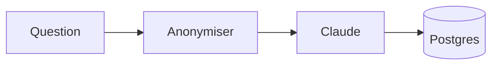

# Testing the site and admin

## 1. Test locally first (no Cloudflare account needed)

```bash
npm run check        # ✓ login settings, ✓ local D1 reachable
npm run dev          # http://localhost:3000 — local D1 (kept in .wrangler/); uploads go to Cloudinary
npm run test:e2e     # automated end-to-end run of the checklist below (in a second terminal)
```

Open `http://localhost:3000/admin/ultrapremiumhomosepian/hello`, sign in with `ADMIN_PASSWORD`, and work through the checklist below. Everything (database, image uploads, inbox) works locally.

To test the exact production build in Cloudflare's runtime: `npm run preview` → `http://localhost:8787` (same local data).

To wipe local test data: `npx wrangler d1 execute vishnu-portfolio-db --local --command "DELETE FROM posts; DELETE FROM projects; DELETE FROM messages; DELETE FROM subscribers;"`

## 2. Then on Cloudflare

Follow **Deploy to Cloudflare (first time)** in the README (`wrangler login` → create D1 → `npm run check -- --remote` → `npm run deploy` → `npm run cf:secrets`), then repeat the checklist on `https://<your-site>/admin/ultrapremiumhomosepian/hello`.

The live site uses its **own** D1 database — local test data never reaches it.

## 3. Checklist

**Login**
- [ ] Opening the admin while logged out redirects to `/login`.
- [ ] A wrong password shows "Wrong password." The right one opens the dashboard.
- [ ] Log out returns to the login page. Going back to the dashboard redirects to login again.

**Empty start**
- [ ] A fresh database shows empty states: "Projects are on the way" on the homepage and "The first posts are on their way" on `/blog`.

**Write a post (draft → preview → publish)**
- [ ] **New post**: fill in title (slug fills itself), topic, summary, upload a cover, and write Markdown.
- [ ] **Quick preview** tab renders the Markdown. Try the sample below.
- [ ] **Save draft**: you stay in the editor with "Draft saved", the badge says **Draft**, and the post is **not** on `/blog`.
- [ ] **Save & preview →** opens the real post page with the bottom bar "Draft — not on the site yet".
- [ ] **Approve & publish**: the dashboard says "Post published", and the post appears on `/blog`, on the homepage and at `/blog/<slug>`.

**Edit something that's live**
- [ ] Edit the live post and **Save draft**. The badge says **Live · changes pending**, and the public page still shows the old version.
- [ ] **Preview page → Publish changes** updates the public page.
- [ ] Edit again, then from the preview click **Discard changes**. The editor reloads with the live version.
- [ ] From the preview of a live post, **Unpublish** removes it from `/blog` (the badge says **Unpublished**). **Approve & publish** brings it back.

**Projects**
- [ ] Repeat the same flow with **New project**: card fields + full write-up + screenshot.
- [ ] The published project shows on the homepage, and its card opens `/projects/<slug>`.

**Contact form & newsletter**
- [ ] Send a message from the homepage contact form. It shows "Message sent" and appears in the dashboard's **Inbox** tab; **Reply** opens your email app.
- [ ] Subscribe from the blog or homepage newsletter box. The email appears under **Newsletter subscribers**; **Copy all emails** copies the list.

**Other checks**
- [ ] Reading a post counts a view (refresh the dashboard; it's counted once per browser session).
- [ ] **Delete** asks for confirmation and removes the item and its uploaded images.
- [ ] Using an existing slug for a new post shows "already used by another post".
- [ ] Uploading a file over 4 MB or a non-image shows a clear error.

## Markdown sample

````markdown
## Architecture



| Feature | Works |
|---|---|
| Tables | ✅ |

- [x] Task lists
- ~~Strikethrough~~

```python
def hello(name):
    return f"Hi {name}"
```

Inline $E=mc^2$ and a block:

$$
\sum_{i=1}^{n} i = \frac{n(n+1)}{2}
$$

> [!TIP]
> Callouts: NOTE, TIP, IMPORTANT, WARNING, CAUTION.

A footnote.[^1]

[^1]: Footnote text.
````

## If something fails

- The dashboard shows database errors in full. `npm run check` (local) or `npm run check -- --remote` (Cloudflare) diagnoses the setup.
- Uploads failing: `npm run check` verifies your Cloudinary keys. On the live site, also run `npm run cf:secrets` (uploads the API secret) and `npm run deploy` (passes the cloud name and key).
- Live logs: `npx wrangler tail` (or the Worker's **Logs** tab in the Cloudflare dashboard).
